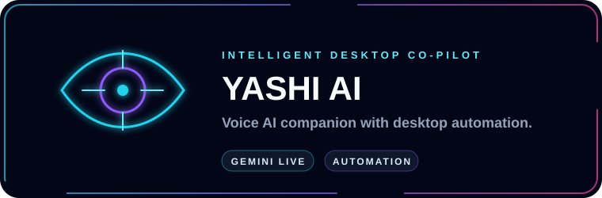
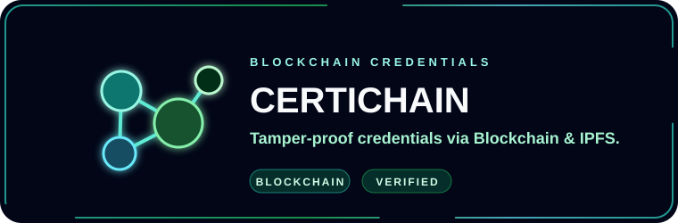
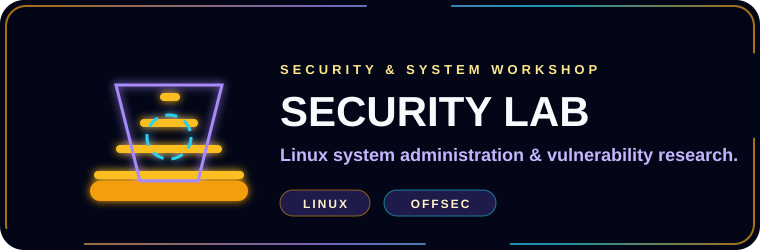
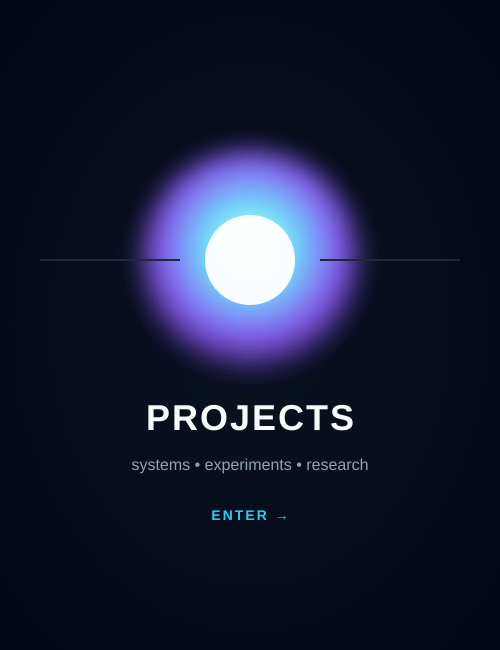
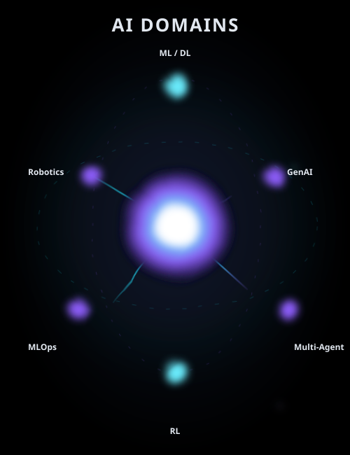
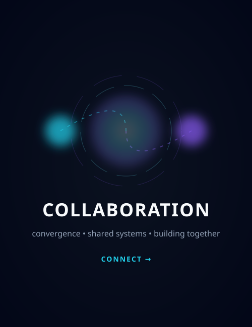

  

<!-- Title -->
<h3 align="center">
    <samp>
        &gt; Hey There!, I am
        <b><a target="_blank" href="https://www.linkedin.com/in/vishnu-kumar-218245380/">Vishnu Kumar</a></b>
    </samp>
</h3>

 

<samp>
「 Breaking things to understand how to protect them • Aspiring Cybersecurity Professional &amp; Bug Bounty Hunter 」
</samp>

  
  
  

  

  <a href="https://dreamy-elf-82a6a8.netlify.app/"><b>Website</b></a>
  &nbsp;|&nbsp;
  <a href="./docs/pages/PROJECTS.md"><b>Projects</b></a>
  &nbsp;|&nbsp;
  <a href="./docs/pages/COLLAB.md"><b>Collaboration</b></a>

<!-- Title -->

  

  

  

# 🛠 Technologies, Projects, and Domains

<table border="0" cellspacing="10" cellpadding="0">
<tr>

<!-- LEFT: TOOLS -->
<td width="420" valign="top" align="center">

<h3>🛠 Technologies</h3>
 

<table align="center" cellspacing="0" cellpadding="6">
  <tr>
    <td align="center"></td>
    <td align="center"></td>
    <td align="center"></td>
    <td align="center"></td>
    <td align="center"></td>
  </tr>
  <tr>
    <td align="center"></td>
    <td align="center"></td>
    <td align="center"></td>
    <td align="center"></td>
    <td align="center"></td>
  </tr>
  <tr>
    <td align="center"></td>
    <td align="center"></td>
    <td align="center"></td>
    <td align="center"></td>
    <td align="center"></td>
  </tr>
  <tr>
    <td align="center"></td>
    <td align="center"></td>
    <td align="center"></td>
    <td align="center"></td>
    <td align="center"></td>
  </tr>
  <tr>
    <td align="center"></td>
    <td align="center"></td>
    <td align="center"></td>
    <td align="center"></td>
    <td align="center"></td>
  </tr>
</table>

</td>

<!-- PROJECTS -->
<td width="260" valign="top" align="center">

<h3>🧪 Projects</h3>
 

  

</td>

<!-- FOCUS DOMAINS -->
<td width="260" valign="top" align="center">

<h3>🛡️ Focus Domains</h3>
 

    

</td>

</tr>
</table>

### 📊 Vital Statistics

  

  

    

  

  
  &nbsp;
  

<table width="100%" border="0" cellspacing="10" cellpadding="0">
<tr>

<!-- LEFT: COLLAB -->
<td width="33%" valign="top">

<h2>🤝 Collaboration</h2>

I’m open to collaborating on:

<ul>
  <li>Web application security &amp; penetration testing</li>
  <li>Bug bounty hunting methodology &amp; recon</li>
  <li>Python automation &amp; security tooling</li>
  <li>AI desktop assistants &amp; developer co-pilots</li>
</ul>

</td>

<!-- MIDDLE: PANEL -->
<td width="34%" align="center" valign="middle">
    
</td>

<!-- RIGHT: CONTACT -->
<td width="33%" valign="top" align="center">

<h2>📫 Contact</h2>

 

  

  

  

</td>

</tr>
</table>

⚡ Breaking things to understand how to protect them. 🔐

Star ⭐ the repos if they helped you!

  <a href="./.github/CODE_OF_CONDUCT.md">Code of Conduct</a> ·
  <a href="./.github/CONTRIBUTING.md">Contributing</a> ·
  <a href="./.github/SECURITY.md">Security</a> ·
  <a href="./docs/README.md">Docs</a> ·
  <a href="./docs/pages/COLLAB.md">Collaboration</a> ·
  <a href="./docs/meta/ROADMAP.md">Roadmap</a> ·
  <a href="./docs/meta/STYLE_GUIDE.md">Style Guide</a> ·
  <a href="./docs/meta/VISUAL_AUDIT.md">Visual Audit</a> ·
  <a href="./docs/meta/SHOWCASE_STRATEGY.md">Showcase Strategy</a> ·
  <a href="./docs/meta/ASSET_INDEX.md">Asset Index</a>

    

  

