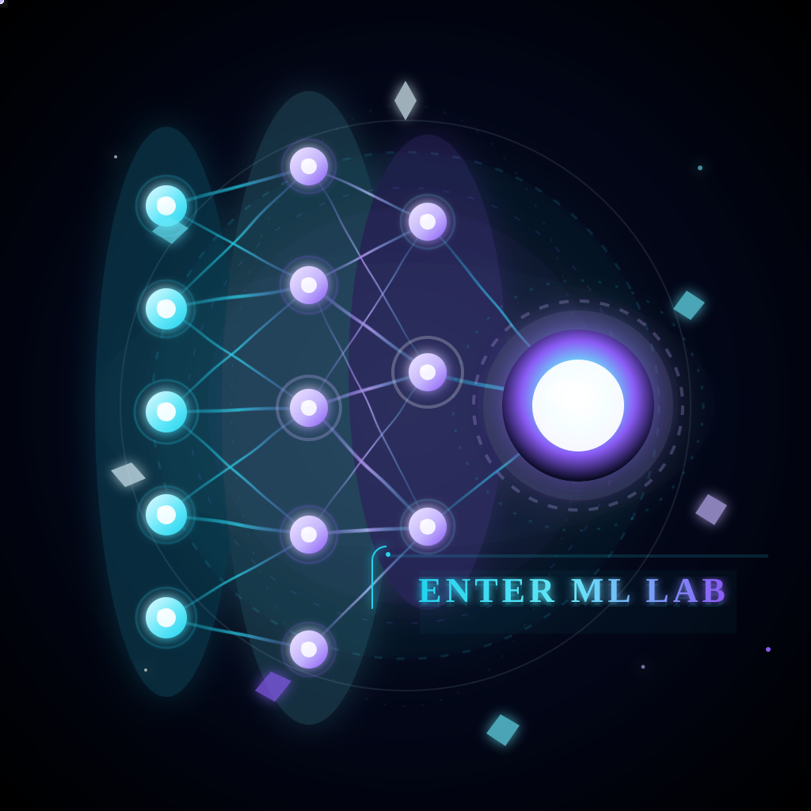

  

  
  
  

  
  
  

---

  <b>The AI areas I care about most are the ones where models, infrastructure, and real-world systems meet.</b>

  This page maps the technical domains behind my projects and labs: machine learning infrastructure, reinforcement learning, robotics, distributed systems, model operations, and interactive education.

    

## Core Domains

  

## Projects & Labs

  <a href="./PROJECTS.md"><b>Open dedicated Projects page</b></a>

| Environment | Purpose |
| --- | --- |
| [Yashi AI](https://github.com/vishnukumar001/Yashi) | Desktop AI companion with voice interaction and task automation. |
| [CertiChain](https://github.com/vishnukumar001/CertiChain) | Tamper-proof digital credentials powered by Blockchain &amp; IPFS. |
| [Security Labs](https://github.com/vishnukumar001/Linux-Journey) | System administration, Linux security, and bug bounty methodologies. |

## Engineering Principles

  

