<p align="center">
  
</p>


<p align="center">
  <a href="../../README.md">
    
  </a>
  <a href="./PROJECTS.md">
    
  </a>
  <a href="./AI_DOMAIN.md">
    
  </a>
</p>

<p align="center">
  <a href="https://dreamy-elf-82a6a8.netlify.app/">
    
  </a>
  <a href="https://dreamy-elf-82a6a8.netlify.app/">
    
  </a>
  <a href="./COLLAB.md">
    
  </a>
</p>


---

<p align="center">
  
</p>


<p align="center">
  <b>Collaboration is most interesting to me when the work has a real purpose behind it: clear security implications, hands-on methodology, and enough curiosity to dig deeper.</b>
</p>

<p align="center">
  I am especially interested in Web Application Security, Bug Bounty Hunting, Python Scripting &amp; Automation, Linux Security, Network Analysis, and AI co-pilots.
</p>

<p align="center">
  
</p>

---

## Collaboration Protocol

I like collaborations where the idea can survive contact with implementation. That usually means the project has a concrete problem, a visible technical path, and enough discipline to turn exploration into something usable.

| Signal | What it means |
| --- | --- |
| `BUILD` | There is a real artifact to design, implement, test, or improve. |
| `RESEARCH` | There is a question worth investigating, not just a vague topic. |
| `SYSTEMS` | The work involves architecture, reliability, scale, reproducibility, or tooling. |
| `LEARNING` | The output helps people understand a difficult technical concept more clearly. |
| `OPEN SOURCE` | The project benefits from public documentation, clean interfaces, and maintainable structure. |

## High-Value Collaboration Zones

### ML Infrastructure & MLOps

Model serving, training workflows, evaluation pipelines, experiment tracking, observability, deployment automation, and platform design. I care about the machinery that makes ML usable beyond notebooks.

### Research Tooling

Systems that make research workflows less fragile: PaperOps, reproducibility, benchmark automation, literature pipelines, experiment metadata, and clean handoff from idea to implementation.

### Reinforcement Learning & Agents

Multi-agent coordination, simulation environments, decision systems, evaluation loops, and agent behavior. I am more interested in measurable behavior than abstract agent hype.

### Robotics & Autonomous Systems

Perception, planning, control loops, embodied AI, and systems that need to operate under real constraints. Good robotics work forces clarity because the world does not accept vague abstractions.

### Interactive Technical Labs

Tools like Neural Lab, Molecule Lab, and Model Forge: visual systems that make complex ideas easier to explore directly. The goal is not decoration; the goal is intuition through interaction.

### Technical Communication & Developer Experience

README systems, diagrams, documentation structure, onboarding flows, and visual interfaces for technical projects. Good engineering is easier to trust when it is easier to inspect.

## What Makes A Strong First Message

The best collaboration message is short, specific, and grounded.

```text
Subject: Collaboration idea: <short project name>

I am building / exploring:
<one or two sentences>

The technical problem is:
<what is hard, unclear, or worth solving>

What exists now:
<repo, demo, paper, sketch, notes, or current status>

Where I think you might fit:
<architecture, ML infra, MLOps, RL, documentation, visual systems, review, etc.>

First useful milestone:
<something small enough to actually start>
```

If the first milestone is clear, the conversation can become technical quickly. That is usually a good sign.

## Good Fit / Poor Fit

<p align="center">
  
</p>

## Operating Style

<p align="center">
  
</p>

## Contact Vector

If the work connects to Cybersecurity, Bug Bounty, Python automation, Linux tooling, or collaborative security research, send the idea through one of the channels listed in the main [README](../../README.md#-contact).

Useful links:

- [Projects](./PROJECTS.md)
- [AI & Security Domains](./AI_DOMAIN.md)
- [Labs](./LABS.md)
- [Portfolio Website](https://dreamy-elf-82a6a8.netlify.app/)
- [GitHub Profile](../../README.md)
