  

  
  
  

  
  
  

---

  

  <a href="https://github.com/vishnukumar001/Yashi"><b>Yashi AI</b></a> ·
  <a href="https://github.com/vishnukumar001/CertiChain"><b>CertiChain</b></a> ·
  <a href="https://github.com/vishnukumar001/Linux-Journey"><b>Security Labs</b></a>

## Launch Hub

The project environments are the hands-on side of this profile: technical implementations for exploring systems directly instead of only reading about them.

| Environment | Status | Value |
| --- | --- | --- |
| [Yashi AI](https://github.com/vishnukumar001/Yashi) | Active / evolving | Explore conversational AI and desktop automation with real-time feedback. |
| [CertiChain](https://github.com/vishnukumar001/CertiChain) | Active | Issue and verify digital credentials on Blockchain and IPFS without intermediaries. |
| [Security Labs](https://github.com/vishnukumar001/Linux-Journey) | Active / evolving | Practical Linux system administration, network analysis, and security exercises. |

## Lab Mission

  

## What Each Project Should Prove

| Project | It should help visitors understand |
| --- | --- |
| Yashi AI | How multi-modal AI and desktop control integrate into a unified assistant. |
| CertiChain | How blockchain immutability solves credential fraud and trust verification. |
| Security Labs | How real system mechanics work under the hood for security defense and bug hunting. |

## Related Pages

- [AI Domains](./AI_DOMAIN.md)
- [Projects](./PROJECTS.md)
- [Portfolio Website](https://dreamy-elf-82a6a8.netlify.app/)
