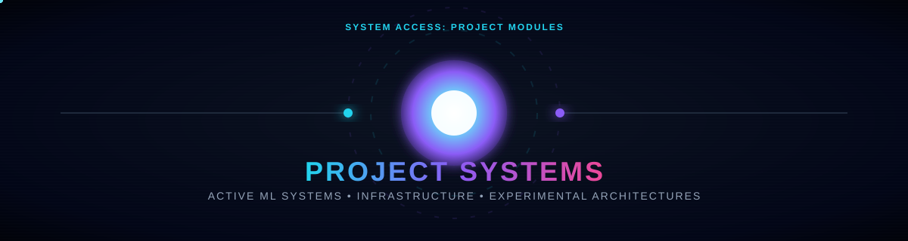
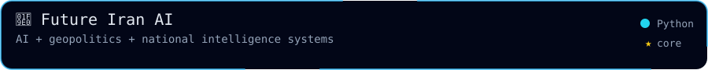
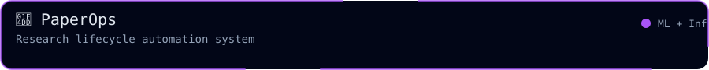
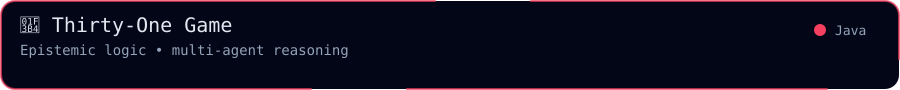
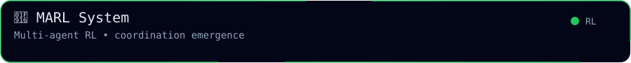

  

  
  
  

  
  
  

---

  <b>Selected work across cybersecurity, AI co-pilots, blockchain verification, and developer tooling.</b>

  This page highlights projects that match the main direction of my GitHub profile: building practical systems, intelligent desktop co-pilots, secure verifiable credentials, and hands-on Linux &amp; networking workflows.

<h2 align="center">🧪 Project Highlights</h2>

<!-- Row 1 -->

  
  

<!-- Row 2 -->

  
  

## Project Index

| Project | Focus | Status | Why it matters |
| --- | --- | --- | --- |
| [Yashi](https://github.com/vishnukumar001/Yashi) | AI Co-Pilot, Desktop Automation, Gemini Live | Active | Combines conversational voice AI, desktop task automation, and a virtual avatar co-pilot. |
| [CertiChain](https://github.com/vishnukumar001/CertiChain) | Blockchain, IPFS, Soulbound NFTs | Active | Turns academic certificates into secure, verifiable digital credentials with tamper-proof verification. |
| [Linux-Journey](https://github.com/vishnukumar001/Linux-Journey) | Linux Administration, Security Tooling | Active | Hands-on documentation, commands, and security workflows to build practical system administration skills. |
| [git-learning-journey](https://github.com/vishnukumar001/git-learning-journey) | Git, GitHub, Version Control | Active | Practical repository documenting Git workflows, branching strategies, and collaboration practices. |

## Current Direction

  

## What To Look At First

  

---

<h2 align="center">📊 Activity</h2>

  

  
    

